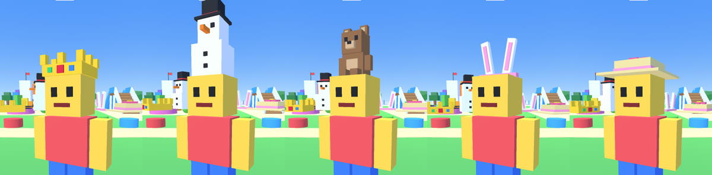
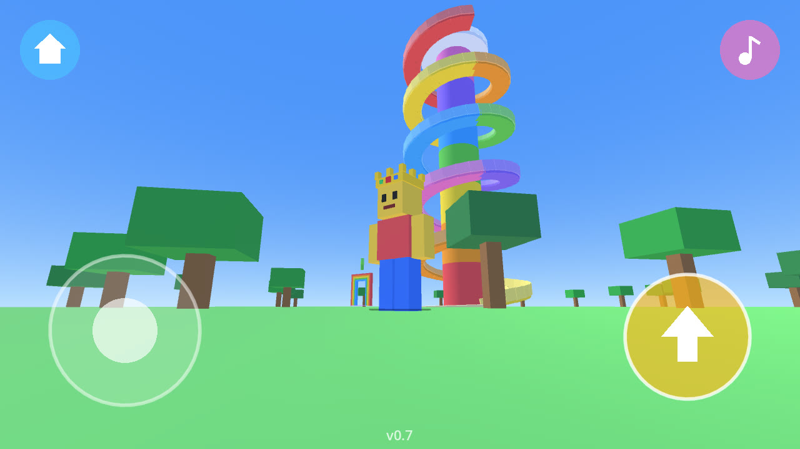
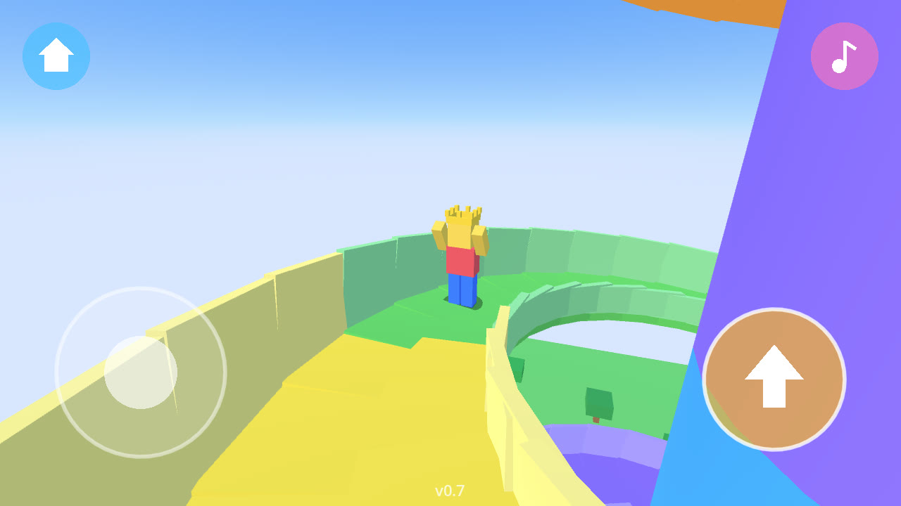
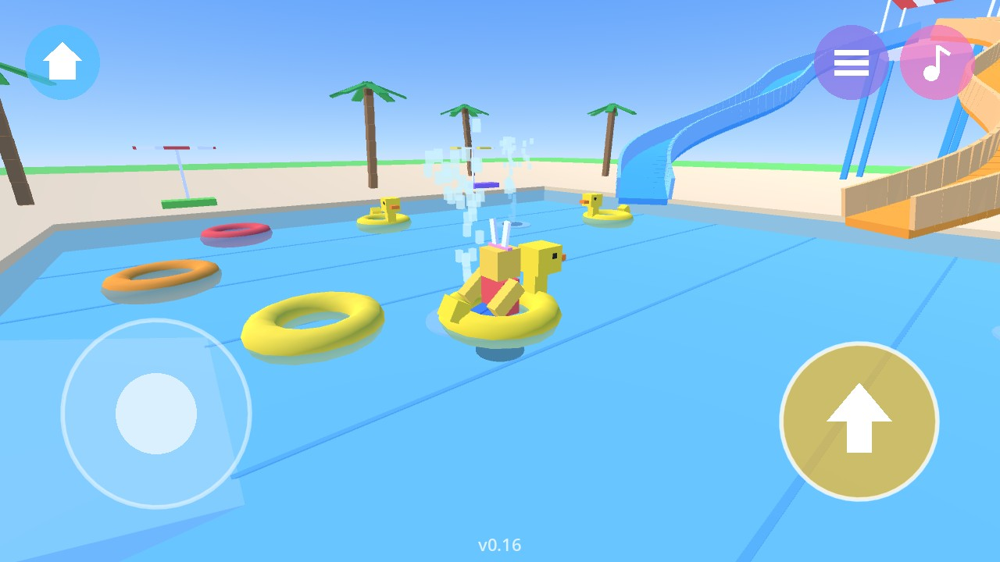
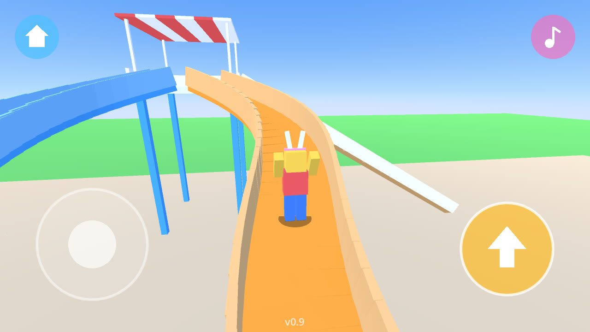
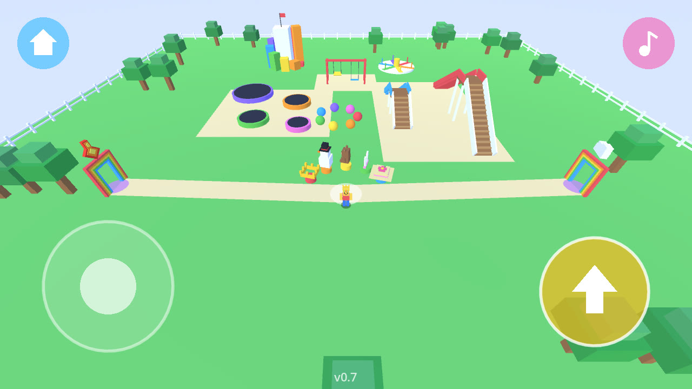
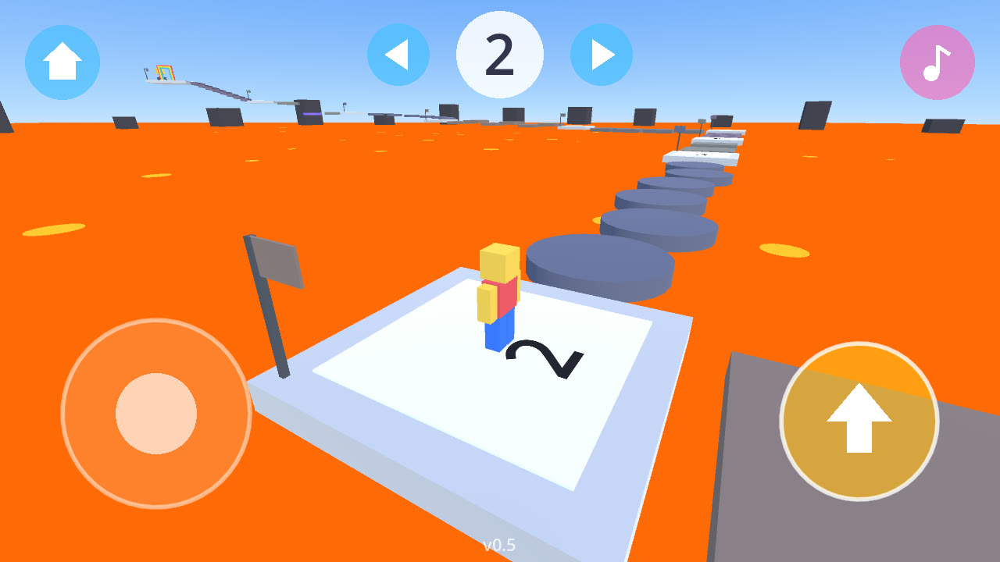
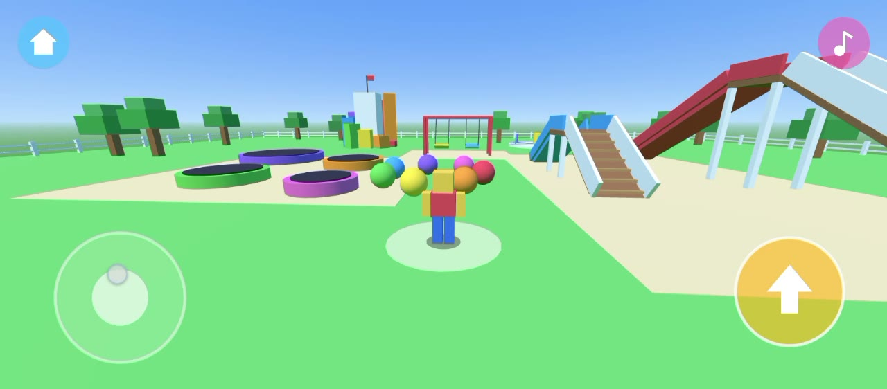

# JumpBox

An offline 3D playground game for little kids, made with Godot 4.7. One big park with
trampolines, slides, swings, a merry-go-round, a block tower and bouncy balls. There is
no way to lose: just play.

**Pick a hat**: at the start, five hats float on little stands: a crown, a snowman, a
teddy bear, bunny ears and a flower hat. Walk up to one and you wear it right away. The
game remembers your hat for next time.



Four rainbow doors in the park lead to bigger adventures. The two jump courses (an
"obby" in Roblox words) each have 10 numbered checkpoints and a golden trophy at the end.
Platforms are wide and gaps are short, made for small kids.

- ☁️ **Sky course** (cloud over the door): easy jumps high above the clouds. Fall into the
  clouds and you come back at your last checkpoint.
- 🔥 **Lava course** (flame over the door): hop across stones over a sea of lava, up to the
  top of a volcano. Touch the lava and you come back at your last checkpoint.
- 🌀 **Giant spiral slide** (little slide over the door, behind the start): you arrive on
  top of a 40 m rainbow tower and slide down five big turns around it, about 20 seconds
  from top to bottom. The camera turns with you. At the bottom, one door takes you up
  again and one takes you home.

| The giant spiral slide | Sliding down |
|---|---|
|  |  |

- 💧 **Water park** (water drop over the door, behind the start): a big pool, waist deep,
  so nobody can sink. Climb the tower and ride one of two curvy water slides down into
  the pool with a big splash. Step on a water jet and it throws you up. Jump onto a
  swim ring or a yellow duck float to sit inside it and paddle around with the joystick
  (the duck turns to look where you go); press jump to get out. Walking in the water is
  a little slower, like real water.

| Water park | On the water slide |
|---|---|
|  |  |

| The park | Lava course |
|---|---|
|  |  |

The doors stand away from the rides: lava on the left, sky on the right, and the spiral
slide and water park behind the start, each with a sand path leading to it.

Only one place is shown at a time (the park or the course you are in), and each course is
built the first time you enter it. This keeps the game light on older phones.

[](docs/demo.mp4)

▶️ [Watch the demo video](docs/demo.mp4) (55 seconds, played on an Android phone)

## Download

📱 **[Download JumpBox.apk](https://github.com/yusufmalikul/jumpbox/releases/latest/download/JumpBox.apk)** (Android 7 or newer, 64-bit phones)

Open the file on your phone to install it. Android may ask you to allow installs from
your browser or file app, and Play Protect may warn because the app is not from the
Play Store; choose "Install anyway". All versions are on the
[Releases page](https://github.com/yusufmalikul/jumpbox/releases).

## Controls

- Left side of the screen: joystick (it appears where your finger lands)
- Yellow button: jump (hold it to keep jumping, and to bounce higher on trampolines)
- Drag on the right side: turn the camera
- Home button (top left): go back to the start
- Menu button (three bars, top right): pause, read about the game, or close the app
- Walk into a swing seat to sit and swing; press jump to get off
- In the water park: jump onto a swim ring or duck float to sit in it, move with the
  joystick, press jump to get out
- On the sky course: the big number at the top is your checkpoint; the arrows next to it
  jump to the previous or next checkpoint if a stage is too hard

On a computer: WASD or arrows to move, Space to jump, Q/E to turn the camera.

## Build the APK

Needs Godot 4.7 (`brew install --cask godot`), JDK 17 (`brew install openjdk@17`) and the
Android SDK (`brew install --cask android-commandlinetools`, then
`sdkmanager "platform-tools" "build-tools;36.1.0" "platforms;android-36"` into
`~/Library/Android/sdk`), plus the Godot 4.7 Android export templates.

```bash
./build.sh   # makes build/JumpBox.apk
```

The first build makes a signing key in `~/.android/jumpbox-release.keystore`. Keep it
safe: new versions only install over the old app if they are signed with the same key.

## Sounds

All sound effects and the music are made from math by `tools/make_sounds.py`
(no downloaded audio). Change it, then run `uv run tools/make_sounds.py` to remake
the files in `assets/`. The music button (top right) turns the music on and off.

## Run on the computer

```bash
godot --path .                                  # play
godot --path . -- --shot=/tmp/shot.png          # save a screenshot after 2 seconds and quit
```

## Tests

```bash
godot --headless --path . -s tests/touch_test.gd   # touch buttons only react inside their circle
```

## Code

The whole park is built from code in `scripts/main.gd`. `player.gd` is the character and
camera, `place.gd` what every place behind a door shares, `course.gd` the shared course logic (checkpoints, platforms) with `sky_course.gd`
and `lava_course.gd` laying out each course, `slide_course.gd` the spiral slide, `water_course.gd` the water park, `hats.gd` the hats, `touch_ui.gd` the on-screen controls, `rides.gd` the moving parts (swings,
merry-go-round), and `util.gd` small helpers for making blocks.
